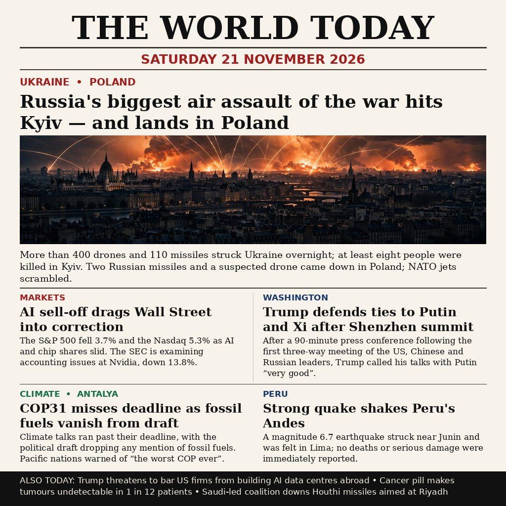

# news-image-20261121 — The World Today: Saturday 21 November 2026

[](https://make.fun/bounty/news-image-20261121)
[](https://make.fun/bounty/news-image-20261121)
[](https://make.fun/bounty/news-image-20261121)

A one-page newspaper front page summing up Saturday 21 November 2026 in a
single image: Russia's huge overnight air assault on Ukraine that also
landed in Poland, the AI-led sell-off that dragged Wall Street into
correction, Trump defending his ties to Putin and Xi after their Shenzhen
summit, COP31 missing its deadline in Antalya, a strong earthquake in
Peru's Andes, and the day's other briefs. The masthead names the day, and
every story is drawn from events first reported on 21 November 2026.



## Run it

```sh
mkdir -p out && MAKEFUN_OUTPUT_DIR=out node main.ts
```

`main.ts` (Node 22+) validates `entry.png` — PNG/JPEG magic bytes, at most
1 MiB, at most 1024×1024 — then copies it to
`$MAKEFUN_OUTPUT_DIR/entry.png` (default `./out`).

## The day's stories

- **Russia's biggest air assault of the war hits Kyiv — and lands in Poland.**
  More than 400 drones and 110 missiles struck Ukraine overnight; at least
  eight people were killed in Kyiv. Two Russian missiles and a suspected
  drone came down in Poland; NATO jets scrambled.
- **AI sell-off drags Wall Street into correction.** The S&P 500 fell 3.7%
  and the Nasdaq 5.3%; the SEC is examining accounting issues at Nvidia,
  down 13.8%.
- **Trump defends ties to Putin and Xi after Shenzhen summit.** After a
  90-minute press conference following the first three-way meeting of the
  US, Chinese and Russian leaders, Trump called his talks with Putin "very
  good".
- **COP31 misses deadline as fossil fuels vanish from draft.** Talks in
  Antalya ran past their deadline; Pacific nations warned of "the worst COP
  ever".
- **Strong quake shakes Peru's Andes.** A magnitude 6.7 earthquake struck
  near Junin and was felt in Lima; no deaths or serious damage were
  immediately reported.
- **Also today:** Trump threatens to bar US firms from building AI data
  centres abroad; a cancer pill makes tumours undetectable in 1 in 12
  patients in trial; the Saudi-led coalition downs Houthi missiles aimed
  at Riyadh.

Sources: Reuters, AP, BBC, The Hindu, The Japan Times, oneturn.news,
Dunya News, Izvestia (21 November 2026 editions).

## Licence

MIT — see [LICENSE](LICENSE).

---

Optional: earn referral rewards, a second way to make money —
[make.fun/r/c5nt5ce8](https://make.fun/r/c5nt5ce8)
